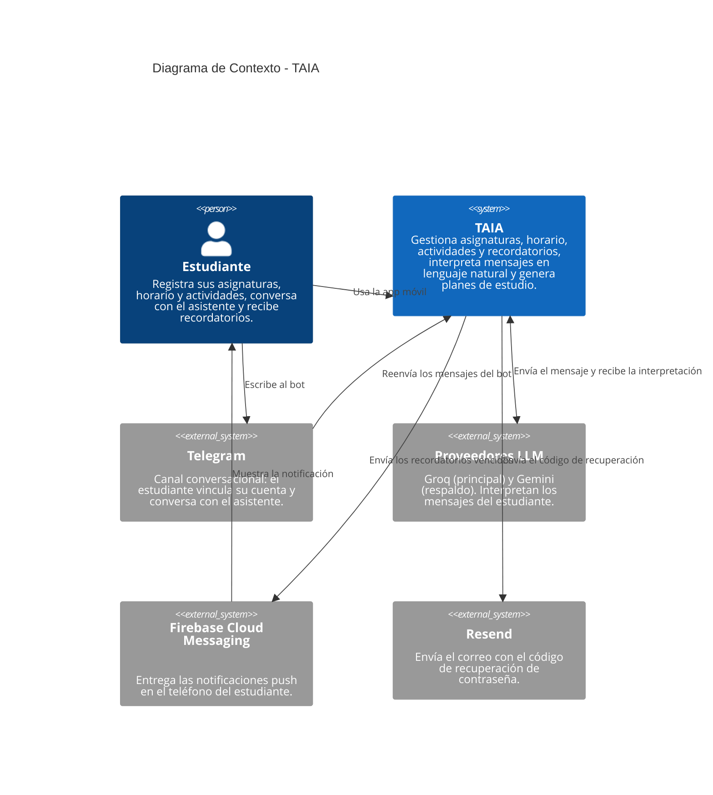

# Diagrama de Contexto - TAIA
### Task Artificial Intelligence Assistant

**Convenciones**

| Color | Significado |
| ----- | ----------- |
| Azul oscuro | Persona (actor humano) |
| Azul | Sistema en alcance del proyecto |
| Gris | Sistema externo (no lo construimos ni lo controlamos) |

El orden de los proveedores LLM está en [ADR-0013](../adr/0013-usar-groq-como-proveedor-llm-principal.md) y el envío de recordatorios en [ADR-0012](../adr/0012-enviar-recordatorios-con-un-proceso-dentro-de-la-api.md).
