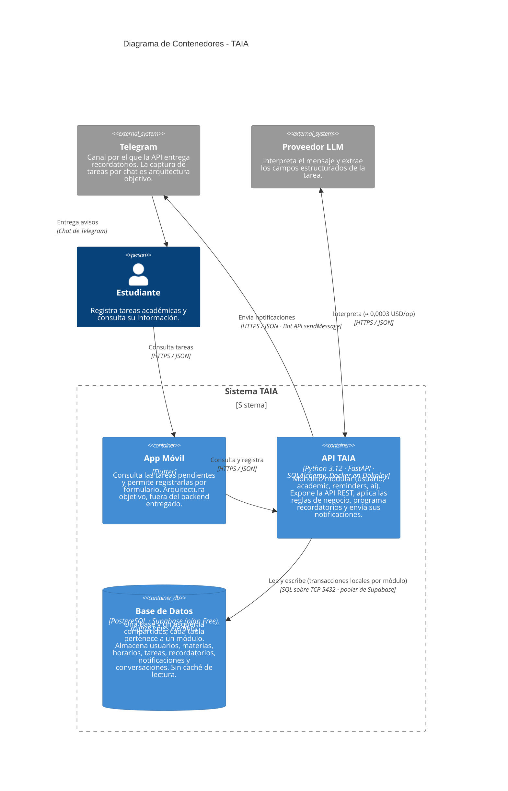

# Diagrama de Contenedores - TAIA
### Task Artificial Intelligence Assistant

**Convenciones**

| Color | Significado |
| ----- | ----------- |
| Azul oscuro | Persona (actor humano) |
| Azul claro | Contenedor (unidad ejecutable o de almacenamiento) |
| Gris | Sistema externo (no lo construimos ni lo controlamos) |

**Almacenes y brokers.** TAIA tiene un solo almacén, PostgreSQL en Supabase ([ADR-0004](../adr/0004-plataforma-base-de-datos.md)), compartido por los cuatro módulos con referencias lógicas entre ellos ([ADR-0009](../adr/0009-base-compartida-con-referencias-logicas-entre-modulos.md)). No hay caché ni broker de mensajes: las integraciones son llamadas HTTP síncronas ([ADR-0002](../adr/0002-estrategia-integracion-api-sincrona.md)); consistencia y caché en [arc42 §8.10 y §8.11](../arc42/08-conceptos-transversales.md#810-consistencia-de-los-datos). La versión de PostgreSQL de producción no está verificada en el repositorio; el CI usa `postgres:17`.

Costo del proveedor LLM medido en [resultado_s1_s3.json](../evaluacion_ia/resultado_s1_s3.json) (0,000312 USD por operación); comportamiento ante fallo en [ADR-0007](../adr/0007-comportamiento-ante-fallo-del-proveedor-llm.md).

