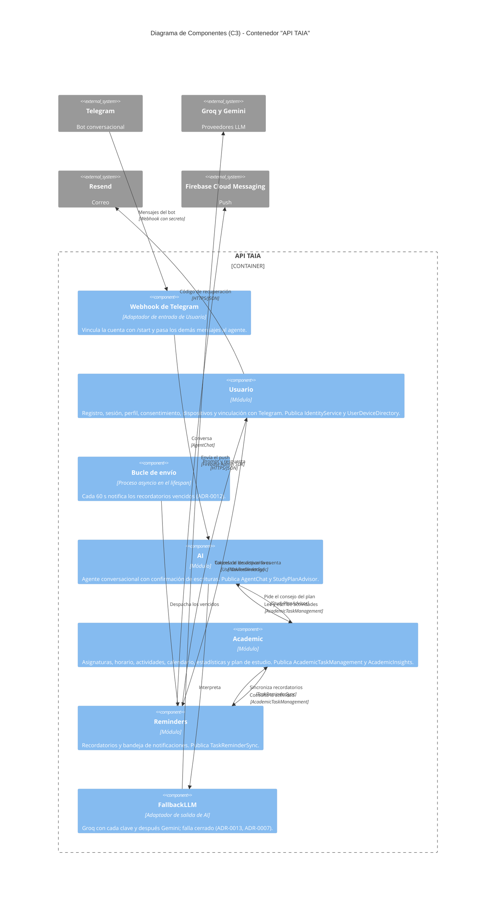

# Diagrama de Componentes - API TAIA
### Task Artificial Intelligence Assistant

Nivel C4-3 del sistema TAIA: zoom sobre el contenedor **API TAIA**. Cada componente es un módulo de `backend/app/modules/` o una pieza que merece verse aparte. Las flechas entre módulos son llamadas a los puertos de entrada que publica el módulo propietario; ningún módulo importa los adaptadores de otro, y `tools/audit_boundaries.py` lo comprueba en el CI.

Para que el diagrama se pueda leer, tres relaciones que comparten todos los módulos quedan fuera de las flechas:

- La app móvil llama a las rutas REST de cada módulo (HTTPS/JSON con JWT, [contrato](../api/openapi.json)).
- Cada módulo lee y escribe solo sus tablas de PostgreSQL ([propiedad de los datos](../propiedad_datos_s6.md)).
- Todos obtienen el usuario del JWT mediante `IdentityService` de Usuario, desde `backend/app/shared/adapters/inbound/auth.py`.
